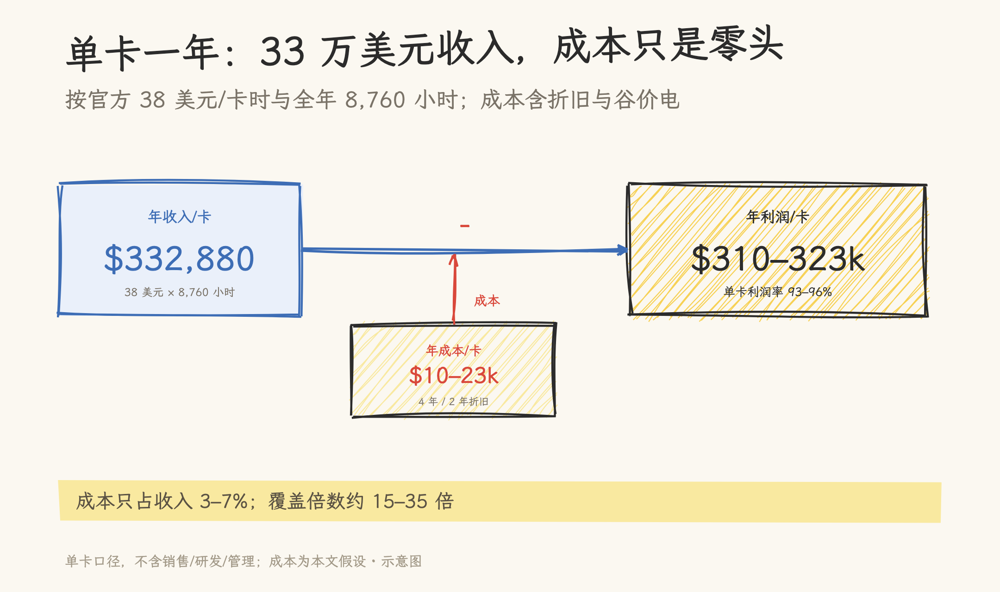
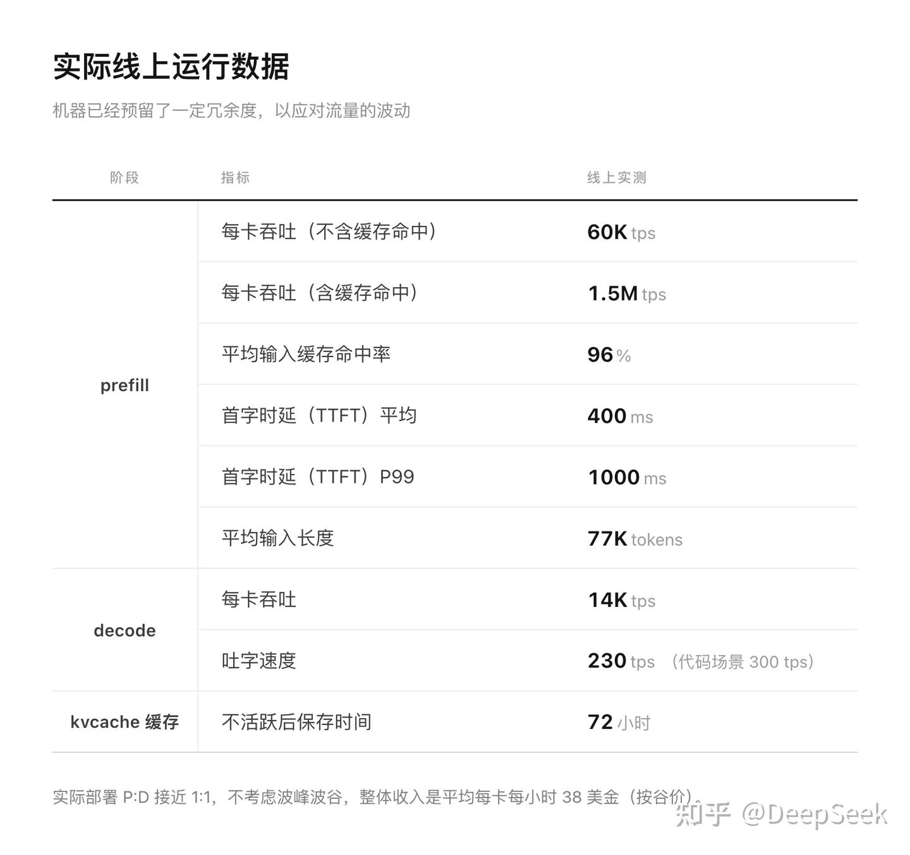
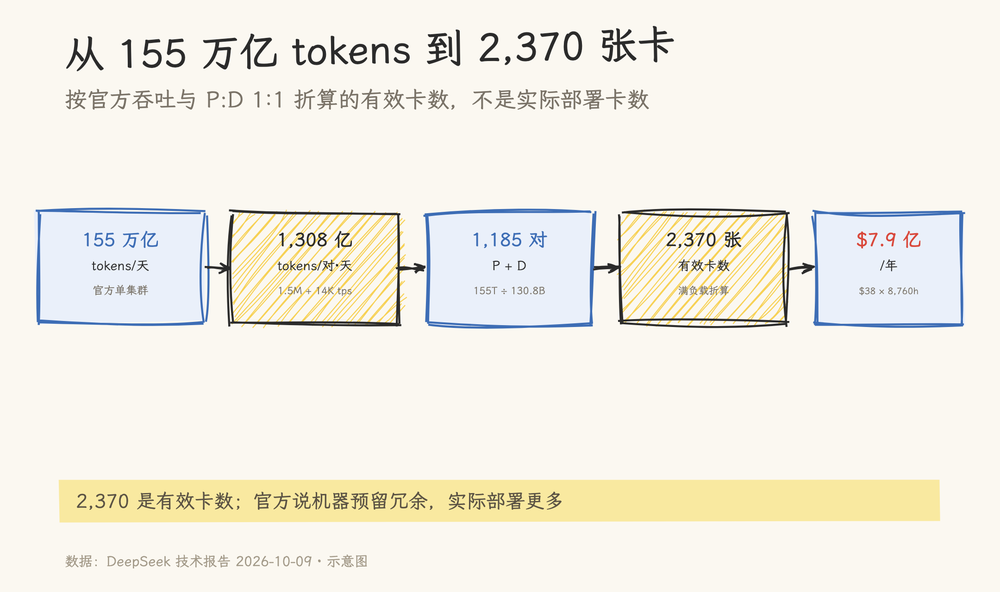
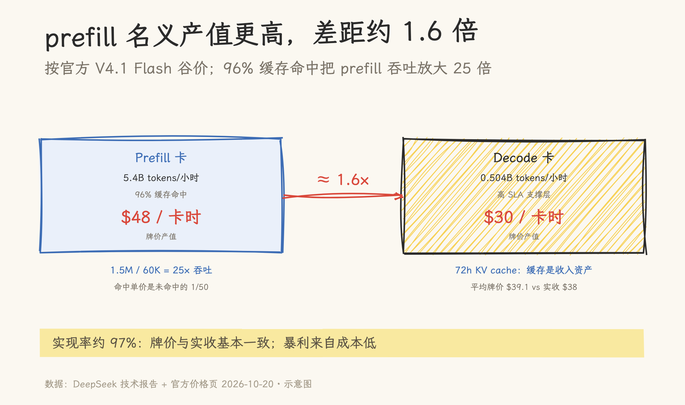

# 155 万亿 tokens/天，单卡运营利润率 93%：token 生意可以做成暴利

> DeepSeek 官方披露的运营数字，加上一组保守成本假设：单卡年收入 33 万美元，成本只占 3–7%。这套账本只属于长上下文、高缓存命中、满载运营的玩家。

先看结论：按官方数据，一张卡一年收入 33 万美元；按 2 年折旧，单卡运营利润率 93%，按 4 年折旧是 96%。**token 生意可以做成暴利。**

这不是营销话术。155 万亿 tokens/天、96% 缓存命中、38 美元/卡时都是 DeepSeek 官方披露的生产参数；这篇文章把它们拆成可复算的单卡账本，并标出哪些是官方数据、哪些是成本假设。

暴利有前提：77K 长输入、96% 命中、P:D 1:1、满载运营。DeepSeek 的推理架构会按负载调整 P/D 配比、缓存和调度，换一种负载不能直接套用；这套账本属于把工程效率做到极致的玩家，不是行业平均。

先看结论图，再拆官方参数、卡数、单卡收入和成本结构，最后看 P/D 产值与边界。



## 一、官方披露了一组很少见的生产参数

DeepSeek 这次没有只讲模型能力，而是给了一张“实际线上运行数据”表。核心参数如下：

| 阶段 | 指标 | 线上实测 |
| --- | --- | --- |
| prefill | 每卡吞吐（不含缓存命中） | 60K tps |
| prefill | 每卡吞吐（含缓存命中） | 1.5M tps |
| prefill | 平均输入缓存命中率 | 96% |
| prefill | 首字时延（TTFT）平均 / P99 | 400ms / 1000ms |
| prefill | 平均输入长度 | 77K tokens |
| decode | 每卡吞吐 | 14K tps |
| decode | 吐字速度（每用户） | 230 tps（代码场景 300 tps） |
| kvcache | 不活跃后保存时间 | 72 小时 |
| 部署 | P:D 比例 | 接近 1:1 |
| 收入 | 平均每卡每小时 | 38 美元（按谷价） |



官方对 38 美元的口径是：按谷价、不考虑波峰波谷的平均每卡收入。

这张表里，38 美元只是结果；支撑这个结果的是三个配套数字：

- **96% 的输入缓存命中率**。prefill 处理的 token 绝大多数直接从缓存读取，不需要重新计算。
- **77K 的平均输入长度**。这个长度对应长上下文、多轮工具调用的 agent 类负载。
- **P:D 接近 1:1**。prefill 和 decode 各占一半卡，说明系统是按“长输入、短输出”的负载配比的。

官方同时注明了“机器已经预留了一定冗余，以应对流量的波动”。这句话会影响后面的卡数折算。

另外，14K tps 的 decode 吞吐、230 tps 的单用户吐字速度，可以反推出每张 decode 卡大约服务 50–60 路并发（代码场景约 47 路）。这是一个推导值，不是官方直接给出的指标。

这套服务背后的推理框架是 DeepInfer。DeepSeek 用它支撑 V4.1 Flash 的高吞吐、低延迟推理；2026-10-20，官方公众号宣布将 DeepInfer 开源（Apache 2.0），同步开源 deepseek-recipe 编解码组件（MIT）。DeepInfer 支持分布式推理、推测解码、SWA Bounded Replay、结构化输出，兼容 NVIDIA 与华为昇腾。生产参数本身来自 2026-10-09 的知乎技术报告。

## 二、155 万亿 tokens/天，折合多少张卡

官方文章称，单一集群每天处理 **155 万亿 tokens**。这个总量和每卡吞吐可以互相校验。

按一对卡（1 张 prefill + 1 张 decode）计算：

- prefill：1.5M tps × 86,400 秒 ≈ **1,296 亿 tokens/天**（含缓存命中）
- decode：14K tps × 86,400 秒 ≈ **12.1 亿 tokens/天**
- 合计：约 **1,308 亿 tokens/对·天**

用 155 万亿除以 1,308 亿：

```text
155 × 10^12 ÷ 1.308 × 10^11 ≈ 1,185 对 ≈ 2,370 张卡
```

这个 2,370 是**按满负载吞吐折算出的有效卡数**，不是实际部署的物理卡数。官方说机器预留了冗余，实际部署只会更多，不会更少。把它当成“这套系统等效需要多少张卡在满负荷工作”更准确。

按每卡每小时 38 美元、全年 8,760 小时粗算：

```text
2,370 张 × $38 × 8,760 h ≈ $7.9 亿/年
```

这个数字是按“有效卡数”和官方“平均每卡收入”折算的量级，不是审计过的集群营收；官方说机器预留了冗余，实际部署卡数可能更多，所以这个数字只作规模参考，单卡账本仍以 38 美元/卡时为准。

另一个有用的交叉校验是隐含实收单价：

```text
$76/对·小时 ÷ 5,450M tokens/对·小时 ≈ $0.0139/M tokens
```

这是被缓存命中、免费流量和谷价折扣一起稀释后的全口径实收价，不是牌价。



## 三、单卡账本：33 万美元收入，成本多少

先看收入端。按官方口径：

```text
$38/卡时 × 8,760 小时 = $332,880/卡·年
```

成本端需要一组假设。这里沿用一套偏保守的全栈 capex 估算：整卡、服务器、网络、机房加起来，按 GPU 采购价的 1.5–2 倍计，折合 **3–4 万美元/卡**；电力按谷价；不考虑销售、研发、管理等公司级费用。折旧分两种口径：

| 折旧口径 | 年成本/卡 | 单卡年利润 | 单卡利润率 |
| --- | ---: | ---: | ---: |
| 4 年直线（正常会计） | 约 $10–13k | 约 $320–323k | 约 96% |
| 2 年（GPU 一年一代的经济现实） | 约 $17–23k | 约 $310–316k | 约 93% |

成本折到每卡小时是：

- 4 年折旧：约 $1.1–1.5/卡时，只相当于 38 美元实收的 3–4%；
- 2 年折旧：约 $1.9–2.6/卡时，相当于实收的 5–7%。

换句话说，按 4 年折旧，单卡成本只相当于当前实收的 3–4%；按 2 年折旧是 5–7%。无论哪种口径，覆盖倍数约 15–35 倍。即使收入大幅下滑，只要不跌破每小时 2–3 美元，折旧和电费仍然能覆盖。这里要区分两个比例：成本占实收的比例（3–7%）和实收占牌价产值的比例（约 97%），两者分母不同，不能混用。

再做一次压力测试：如果按 1 年折旧、只算 capex，成本约 $3.4–4.6/卡时，单卡利润率仍约 88–91%；加上电费会略低，但结论不变。**折旧年限是这套账本里最不致命的变量**。

需要强调：93–96% 是**单卡层面的运营利润率**，只扣了折旧和电费，不含销售、研发、管理等费用，也不是公司净利润。官方给的 38 美元是收入，不是利润。

## 四、杠杆在哪里：prefill 卡与 96% 缓存命中

把官方价格页的谷价结构拆开，会看到一个不那么夸张、但更可靠的结论：在这套负载下，**prefill 卡的名义产值仍然更高，decode 卡更像高 SLA 支撑层**；差距约 1.6 倍，不是数量级差异。

按 DeepSeek 官方价格页（2026-10-20 查询）的谷价：`deepseek-flash` / V4.1-Flash-1017 的 cache hit $0.003/M、cache miss $0.15/M、output $0.60/M；高峰时段价格翻倍。官方 38 美元/卡时是“按谷价”，所以这里用谷价。

|  | Prefill 卡 | Decode 卡 |
| --- | ---: | ---: |
| 每小时处理 tokens | 54 亿（96% 为缓存命中） | 0.504 亿 |
| 牌价产值/卡时 | 5,400M × $0.00888/M ≈ **$48** | 50.4M × $0.60/M ≈ **$30** |

prefill 卡的每小时牌价产值约为 decode 卡的 **1.6 倍**。原因有两层：

1. 96% 缓存命中把 prefill 的等效吞吐放大了 25 倍（1.5M / 60K）；
2. 命中单价是未命中的 1/50（$0.003 vs $0.15），但 prefill 处理量足够大，名义产值仍然更高。

72 小时 KV cache 仍有价值：它把“近乎零边际成本的缓存读取”变成可计价的 token 处理量。只是当前牌价下，命中单价只有 1/50，缓存带来的产值杠杆没有吞吐放大那么夸张；它更像一个降低 prefill 单位成本、提高有效吞吐的基础设施。

$48 和 $30 是**牌价产值**，不是实际收入。两张卡的平均牌价产值是 $39.1/卡时，而官方实收是 $38/卡时，实现率约 **97%**。差距只有约 3%，更可能来自取整、流量结构和口径，而不是大幅折扣。这意味着官方 38 美元基本就是按当前谷价和 96% 命中算出来的平均 token 收入；**暴利来自成本低，而不是“高牌价、低实收”的折扣差。**



## 五、价格与折旧：两个敏感性变量

这套账本对应的是 77K 输入、96% 缓存命中、P:D 1:1 的当前负载。DeepSeek 的推理架构会按负载调整 P/D 配比、缓存和调度，所以其他负载下的单卡数字不能直接套用；这是一套当前 agent 负载口径下的单卡模型，不是通用推理利润率。这里只对牌价和折旧做敏感性分析。

**第一，牌价。** 收入以 token 牌价计价，成本却主要是锁死的折旧和电费。假设用量不变、牌价减半，单卡收入减半，折旧不变；按 2 年折旧口径，利润率会从 93% 降到 86% 左右。如果牌价继续下行，压力会逐步显现。现实中价格下降可能带来用量增长，结果取决于需求弹性，不能只看单价。

**第二，折旧年限。** 这是最不致命的变量。按 1 年折旧、只算 capex，单卡利润率仍有 88–91%；按 4 年折旧则是 96%。只要负载和价格不崩，折旧年限改变的是“赚多少”，不是“赚不赚”。

| 变量 | 变化 | 对单卡账本的影响 |
| --- | --- | --- |
| 牌价 | 减半（用量不变） | 收入减半，利润率约降到 86% |
| 折旧 | 4 年 → 1 年 | 成本升到 $3.4–4.6/卡时，利润率仍 88–91% |

## 六、这对行业意味着什么

第一，**推理不是一门同质化生意**。同样是卖 token，输入长度、缓存命中率、并发密度不同，运营者会按自己的负载调整架构，单卡产出也会不同。DeepSeek 这组数据的价值，在于给出了一种把长上下文、缓存和 P:D 配比做到极致的运营形态。

第二，**同样的 GPU，在不同运营者手里是不同的资产**。高负载、高缓存命中的集群，单卡能产生稳定现金流；低利用率、短上下文的集群，同一张卡可能连折旧都覆盖不了。对 GPU 租赁、融资和资产处置来说，抵押品的价值不只取决于卡的价格，还取决于运营者的负载质量。这是这组数据对产业链更长远的影响。

第三，**价格战的地板由工程效率最高的玩家决定**。当头部玩家的单卡成本只占实收的个位数百分比时，它有空间主动降价；而效率较低的玩家，降价就是亏现金。这解释了为什么同样做推理服务，有的厂商能打价格战，有的不能。

第四，**规模量级**。据 21 世纪经济报道 2026-08-28 的报道，截至 2026 年 6 月，我国日均词元调用量已突破 500 万亿。按这个口径，155 万亿/天大约相当于全国日调用量的 31%。两个数字的口径不完全可比（单集群 tokens vs 全国词元调用量），这里只作规模参照，不作市场份额结论。

第五，**框架开源降低了复现门槛，但没有消除经营门槛**。DeepSeek 这次同时开源了 DeepInfer（Apache 2.0），这套调度和缓存优化可以被更多团队复用；但模型权重、负载质量和运营能力仍然是门槛，框架开源不等于单卡账本能自动复制。

## 七、口径、假设与限制

- **官方数据按官方口径采信**。155 万亿 tokens/天、96% 缓存命中、38 美元/卡时均来自 DeepSeek 官方披露，这篇文章以此为准。
- **38 美元是收入，不是利润**。93–96% 是单卡层面的运营利润率，只扣折旧和电费，不含销售、研发、管理等费用，也不是公司净利润。
- **成本是假设**。3–4 万美元/卡的全栈 capex、谷价电、4 年/2 年/1 年折旧都是这里的估算；真实 capex、电价、利用率和融资成本会改变结果。
- **牌价按官方价格页（2026-10-20）的谷价**。`deepseek-flash` / V4.1-Flash-1017：cache hit $0.003/M、miss $0.15/M、output $0.60/M；高峰时段翻倍。如果后续调价，$48/$30 和 97% 的实现率要按比例重算。
- **2,370 是有效卡数**。官方说机器预留了冗余，实际部署卡数可能更多；集群收入只能作量级参考。
- **500 万亿是媒体口径**。该数字来自公开报道，统计时点为 2026 年 6 月；155 万亿与它的比较只作规模参照。
- 不构成投资建议。

## 信源

- DeepSeek 官方公众号：《[DeepSeek 开源推理框架：走向真正普惠的未来](https://mp.weixin.qq.com/s/5MEu2eeqNfBWXlkCKTd6sg)》，2026-10-20。
- DeepSeek 官方知乎账号：《[DeepSeek V4.1 Flash 大规模推理部署实践](https://zhuanlan.zhihu.com/p/2095560295930508953)》，2026-10-09。原文有反爬限制，核心参数以文中官方披露图为准。
- DeepInfer（Apache 2.0）：[github.com/deepseek-ai/DeepInfer](https://github.com/deepseek-ai/DeepInfer)；deepseek-recipe（MIT）：[github.com/deepseek-ai/deepseek-recipe](https://github.com/deepseek-ai/deepseek-recipe)。
- 21 世纪经济报道：《[我国日均词元调用量已突破 500 万亿](https://m.21jingji.com/article/20260828/herald/c6fefb8682297807c9c5293dc735bc8a.html)》，2026-08-28。
- DeepSeek 开放平台价格页（2026-10-20 查询，USD 谷价）：[中文页](https://api-docs.deepseek.com/zh-cn/quick_start/pricing/)｜[英文页](https://api-docs.deepseek.com/quick_start/pricing)。
